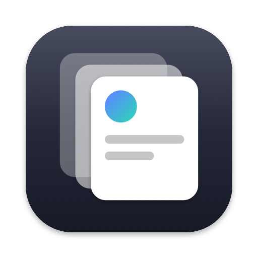
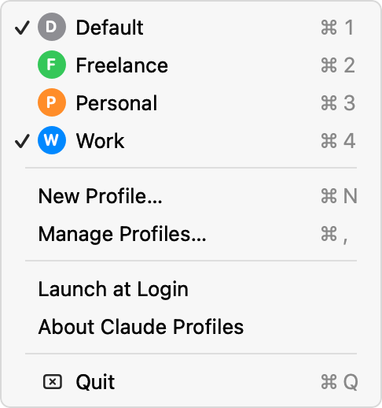
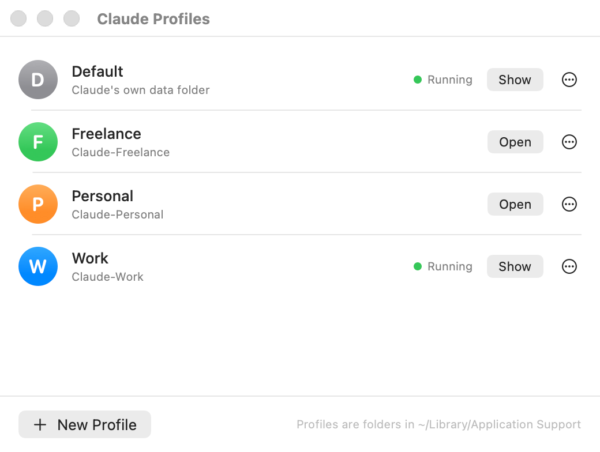
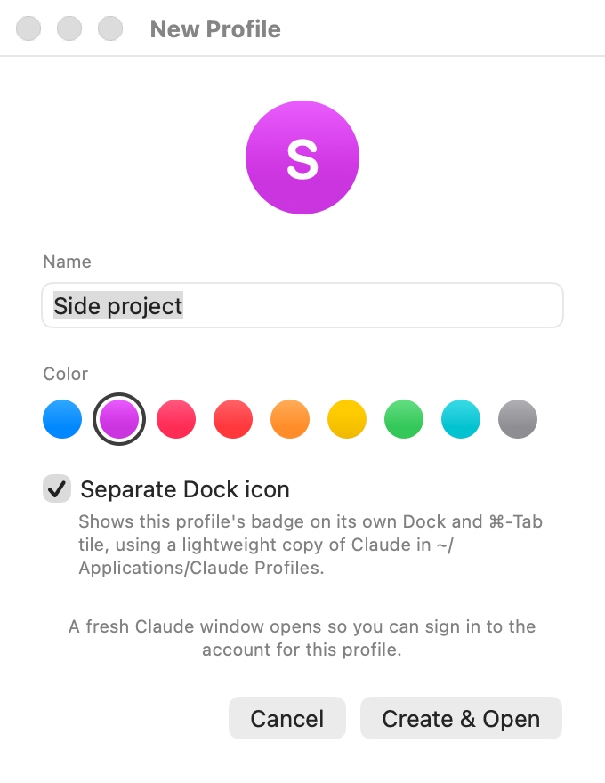

<p align="center">
  
</p>

<h1 align="center">Claude Profiles</h1>

<p align="center">
  Run several Claude accounts side by side on your Mac.<br>
  A menu bar app that gives each account its own Claude window.
</p>

<p align="center">
  <a href="https://github.com/Mutesa-Cedric/claude-profiles/releases/latest"></a>
  <a href="https://github.com/Mutesa-Cedric/claude-profiles/actions/workflows/ci.yml"></a>
  
  <a href="LICENSE"></a>
</p>

<p align="center">
  <picture>
    <source media="(prefers-color-scheme: dark)" srcset="docs/screenshots/menu-dark.png">
    
  </picture>
</p>

## Why

The Claude desktop app signs in to one account at a time. If you have a work account and a personal one, or a few client accounts, you end up signing out and back in all day.

Claude is an Electron app, and Electron keeps one process per data folder. Give each account its own folder and you can run them all at once. Claude Profiles does exactly that from the menu bar: each profile is a folder, and opening a profile launches Claude pointed at it.

## What you get

- **One click per account.** Pick a profile from the menu bar (or press ⌘1…⌘9 while it's open). If that profile is already running, its window comes forward instead of opening twice.
- **Profiles stay signed in.** Each one keeps its own login, settings, MCP servers and connectors.
- **A proper management window.** Rename, recolor, reveal in Finder, quit, or delete a profile. Deleting moves the folder to the Trash so you can undo it.
- **Separate Dock icons.** Each profile gets its own badged tile in the Dock and ⌘-Tab, named “Claude · Work”, instead of blending into the main Claude tile. On by default, switchable per profile. See [below](#separate-dock-icons).
- **Launch at Login** so the menu bar item is always there.
- **Scriptable.** `--open <name>` and `--list` work from the shell, Raycast, Alfred or a Shortcut.
- **Nothing phones home**, nothing is injected into Claude, and Claude's own folders are never modified. The app only passes a launch flag.

<p align="center">
  <picture>
    <source media="(prefers-color-scheme: dark)" srcset="docs/screenshots/manage-dark.png">
    
  </picture>
</p>

<p align="center">
  <picture>
    <source media="(prefers-color-scheme: dark)" srcset="docs/screenshots/new-profile-dark.png">
    
  </picture>
</p>

## Install

Requires macOS 14 Sonoma or later and [Claude for Mac](https://claude.ai/download).

### Download

1. Grab `Claude Profiles.zip` from the [latest release](https://github.com/Mutesa-Cedric/claude-profiles/releases/latest) and unzip it.
2. Move **Claude Profiles.app** to `~/Applications` (or `/Applications`).
3. The build is not notarized, so the first time, right-click the app and choose **Open**. If macOS still refuses, run:

   ```bash
   xattr -dr com.apple.quarantine ~/Applications/Claude\ Profiles.app
   ```

### Build from source

You need Xcode 16 or later.

```bash
git clone https://github.com/Mutesa-Cedric/claude-profiles.git
cd claude-profiles
make install
```

`make install` builds a universal release binary, bundles it, copies it to `~/Applications` and launches it.

## Use

1. Click the profiles icon (a stack of cards) in the menu bar and choose **New Profile…**
2. Give it a name and a color. A fresh Claude window opens; sign in with the account you want for this profile.
3. From then on, pick the profile from the menu to open or focus it.

**Default** is your existing Claude installation and stays untouched.

### From the command line

```bash
# Open or focus a profile by name
"/Applications/Claude Profiles.app/Contents/MacOS/ClaudeProfiles" --open Work

# See every profile and whether it's running
"/Applications/Claude Profiles.app/Contents/MacOS/ClaudeProfiles" --list
```

A shell alias makes that pleasant:

```bash
alias claude-profile='"$HOME/Applications/Claude Profiles.app/Contents/MacOS/ClaudeProfiles" --open'
claude-profile Work
```

## Signing in to a profile

Claude signs in through your browser and comes back to the app through a `claude://` link. macOS delivers that link to whichever running Claude instance it picks — in testing, reliably *not* the window you started from. With two profiles open, a login started in Personal can land in Default, both end up on the same account, and a later logout in one takes the other down with it.

Claude Profiles guards against this:

- **Create & Open** and **⋯ → Sign In…** check whether other profiles are open. If so, they offer to quit them for the duration of the sign-in, so the link has exactly one place to go.
- Afterwards, a **Reopen …** item at the top of the menu (and a button in Manage Profiles) brings the quit profiles back.

If your profiles are already mixed up: for each one, choose **⋯ → Sign In…**, accept the prompt, log out inside that window, and log in with the account you want. Then reopen the rest.

## Separate Dock icons

Every profile gets its own tile in the Dock and ⌘-Tab: Claude's icon with the profile's colored initial, labelled “Claude · Work”. This is on by default; switch **Separate Dock icon** off for a profile (in the New Profile window, or from the **⋯** menu in Manage Profiles) and it runs from `Claude.app` itself and shares Claude's tile instead.

Under the hood the profile launches through a per-profile copy of Claude at `~/Applications/Claude Profiles/Claude · Work.app`. The copy is an APFS clone, so it's instant and takes no extra space, and nothing inside it is modified — only a Finder custom icon is attached — so it launches exactly like the original. (Gatekeeper re-checks a copied app's signature on first launch and would reject any edited file inside it as “damaged”, which is why the name comes from the copy's file name rather than from its Info.plist.)

Worth knowing:

- The window title and the app menu still say “Claude”; Claude sets those itself.
- When Claude updates, a copy becomes stale and holds its own ~650 MB until it's refreshed. Claude Profiles refreshes it automatically the next time you open that profile (as long as it isn't running).
- A running copy may also download the update itself, like any Claude install.
- Switching the option off, renaming the profile, or deleting it removes the copy. Copies are only ever deleted when they aren't running.

## How it works

A profile is a folder next to Claude's own data folder:

```
~/Library/Application Support/
├── Claude/                 ← the Default profile (Claude's own folder)
├── Claude-Work/            ← a profile
├── Claude-Personal/        ← another profile
└── Claude Profiles/
    └── profiles.json       ← names and colors, owned by this app
```

Opening a profile runs the equivalent of:

```bash
open -n -a Claude --args --user-data-dir="$HOME/Library/Application Support/Claude-Work"
```

Running profiles are detected by reading the process table and matching that flag. Any `Claude-*` folder you create by hand shows up in the menu too.

## Caveats

- **Unofficial.** This relies on Claude being an Electron app that honors `--user-data-dir`. An update could change that, in which case profiles would open the default account until this app is updated.
- **Shared Dock icon when the option is off.** A profile with *Separate Dock icon* switched off shares Claude's Dock tile and ⌘-Tab entry. The menu marks running profiles with a checkmark and brings the right window forward either way.
- **Features tied to the system** such as the global shortcut or `claude://` links go to whichever instance macOS picks. For sign-in links the app works around this (see [Signing in](#signing-in-to-a-profile)); other deep links may still open in a different profile than you expect.
- **Launch at Login** needs the app to live in `~/Applications` or `/Applications`.

## Development

```bash
make build        # debug build
make test         # unit tests for the core module
make run          # bundle and launch
make selftest     # install, then drive the real UI end to end against Claude (launches and quits one instance)
make screenshots  # regenerate docs/screenshots from the real UI with demo data
make icon         # regenerate the app icon from Scripts/make-icon.swift
make release      # zip the app for a GitHub release
```

The package has two targets: `ClaudeProfilesCore` (profile discovery, metadata, process detection; no AppKit, fully unit-tested) and `ClaudeProfiles` (the AppKit + SwiftUI app). Releases are built and published by GitHub Actions when a `v*` tag is pushed.

`make selftest` is the integration test: it creates a profile in a temp folder through the real New Profile window, waits for Claude to launch, presses the real buttons in the Manage window, renames, quits, trashes, and toggles Launch at Login (restoring it). Buttons are pressed through the app's own accessibility tree, so no extra permissions are needed, and your actual profiles are never touched.

## License

[MIT](LICENSE). Claude is a trademark of Anthropic, PBC. This project is not affiliated with or endorsed by Anthropic.
